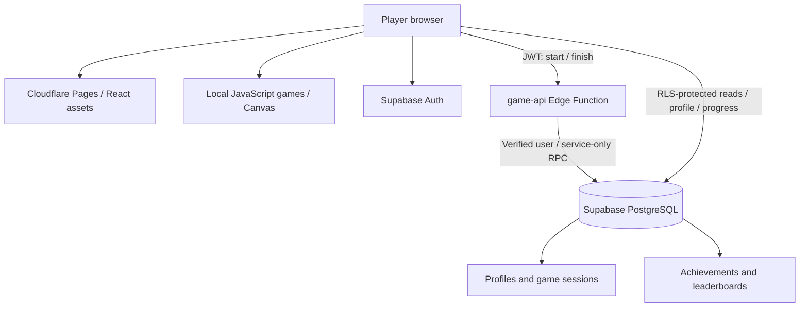

# CloudArcade

A React arcade with Snake, 2048, and Space Shooter, backed by Supabase Auth, PostgreSQL and a protected Edge Function. Designed for deployment to Cloudflare Pages.

## Run locally

Requires Node.js 22.12+ (Node 24 is supported).

```powershell
cd D:\cloud_computing\cloudarcade
npm.cmd install
npm.cmd run dev
```

Open the address Vite prints, normally http://127.0.0.1:5173. No cloud credentials are required for **local guest mode**. Guest scores, badges, display name, and saved 2048 progress live in this browser's localStorage. Guest mode is not authentication and does not participate in shared leaderboards. Cloud users have separate data; guest records are not uploaded on sign-in.

```powershell
npm.cmd test
npm.cmd run build
npm.cmd run preview
```

To run the browser checks, install Chromium once with `npx playwright install chromium`, then run `npm run test:browser`. `npm test` includes game-rule tests and an isolated PostgreSQL-compatible database security test using PGlite; it does not touch a live cloud database.

Screenshots: [desktop dashboard](docs/dashboard-desktop.png) · [mobile dashboard](docs/dashboard-mobile.png). Report draft: [project report](docs/PROJECT-REPORT.md).

## Features

- Responsive dark interface, landing page, dashboard and searchable game library.
- Canvas Snake and Space Shooter; keyboard and swipe-enabled 2048. All games include touch controls.
- Pause, restart, score submission with retry, personal records and recent activity.
- 2048 save/resume locally or across devices when signed in. Saving does not submit a score; choose Finish run to record it.
- Supabase email/password registration, confirmation, login, recovery and logout.
- Six server-awarded achievements, per-game and aggregate leaderboards, last-seven-days filter.
- Profile editing, admin statistics, recent leaderboard activity and catalog availability controls.
- RLS, restricted column grants, transactional score validation, idempotent completion and start throttling.

## Connect Supabase

1. Create a Supabase project in your own account. Keep the database password and service-role key private.
2. Run `supabase/migrations/202610270001_initial.sql` once in the project's SQL Editor. Alternatively, install the Supabase CLI and use `supabase link` and `supabase db push`.
3. Copy `.env.example` to `.env.local`. Fill in the project's URL and its public publishable/anon key from project settings. **Never put the service-role key in any `VITE_` variable.** Restart Vite after changing configuration.

```dotenv
VITE_SUPABASE_URL=https://YOUR-PROJECT.supabase.co
VITE_SUPABASE_ANON_KEY=YOUR_PUBLIC_KEY
```

4. Deploy the Edge Function from this project directory (CLI login requires your account):

```powershell
npx supabase login
npx supabase link --project-ref YOUR_PROJECT_REF
npx supabase functions deploy game-api
```

The Supabase runtime supplies `SUPABASE_URL` and `SUPABASE_SERVICE_ROLE_KEY`. `verify_jwt = false` in the function configuration disables the gateway's legacy check; **the handler still authenticates every request with `auth.getUser(token)` before invoking protected operations**. It never accepts a user ID from the request body.

5. In Authentication → URL Configuration, set the production Site URL and add these development redirect URLs:
   - `http://127.0.0.1:5173/dashboard`
   - `http://127.0.0.1:5173/auth?mode=update`
   - The corresponding production `/dashboard` and `/auth?mode=update` URLs.
6. Enable email/password authentication. Keep email confirmation enabled. Configure an email provider if the project's built-in mail service cannot send to your test users. Register a new account and follow the confirmation link.

### Grant administrator access

Only the project owner should grant this role, using the SQL Editor:

```sql
update auth.users
set raw_app_meta_data = coalesce(raw_app_meta_data, '{}'::jsonb) || '{"role":"admin"}'::jsonb
where id = 'THE-INTENDED-USER-UUID';
```

Sign out and back in to refresh the token. The `/admin` page checks the role for navigation; database policies and `admin_stats()` independently enforce it. User-editable metadata cannot grant admin privileges. Revoking a role requires token/session revocation or waiting for already-issued tokens to expire.

## Deploy to Cloudflare Pages

1. Create a GitHub repository and push this directory (exclude `.env.local`, `node_modules` and `dist`).
2. In Cloudflare, create a **Pages** project connected to that repository.
3. Framework: React (Vite). Build command: `npm run build`. Output directory: `dist`. Root: repository root, or `cloudarcade` if this folder is nested in your repository.
4. Add both public `VITE_SUPABASE_*` environment variables. Set `NODE_VERSION` to `24` if required by the build environment.
5. Deploy. Add the resulting HTTPS `*.pages.dev` domain to Supabase's Site URL and redirect allowlist.
6. Test a fresh registration and score submission from two browsers/devices. The same authenticated account should show the same saved data.

For a manual deployment, run `npm run build`, then upload the `dist` folder using Pages Direct Upload. Environment values must be present **at build time**; changing dashboard values alone does not alter an already-built bundle.

## Architecture



The cloud hosts application assets, identities, shared data and protected operations. Gameplay is rendered on the player's device, not streamed from a GPU server.

## Project layout

`src/App.jsx` contains the routed screens and shared application state. `src/games/Games.jsx` contains the three playable interfaces; `src/games/logic.js` contains independently tested game rules. `src/services/api.js` separates guest persistence from cloud operations. `src/catalog.js` defines presentation metadata and guest badges. `supabase/` holds deployable database and Edge Function code. `docs/` contains demonstration and security verification guides.

## Limits and deployment status

The repository is a local implementation and deployment package. A Supabase project, live migration, deployed Edge Function, account email configuration and Cloudflare deployment must be provisioned in your own accounts before cloud features work. No public deployment URL or cloud verification is implied by a passing frontend build.

Scores receive sanity checks, not authoritative replay verification. Browser code and saved puzzle state can be manipulated; this is a casual leaderboard, not a competitive anti-cheat system. Overall ranking sums the best score for each game and therefore favors games with higher score scales. Rankings display the top 100 players; signed-in users also see their personal rank even outside the top 100. Dashboard statistics use up to the latest 1,000 completed cloud sessions. Guest storage can be cleared by the browser and is not encrypted. Start throttling is per authenticated account, not global DDoS protection. Paused runs count toward wall-clock play time. Unfinished sessions are abandoned when a new run of the same game begins; sessions expire after 24 hours. An already-started game may finish after an administrator disables new starts.

The ₹0 target depends on staying within provider quotas and account eligibility. Check each provider's dashboard before enabling paid services.

## References

- [Supabase RLS](https://supabase.com/docs/guides/database/postgres/row-level-security)
- [Supabase token validation](https://supabase.com/docs/reference/javascript/auth-getuser)
- [Cloudflare Pages build settings](https://developers.cloudflare.com/pages/configuration/build-configuration/)
