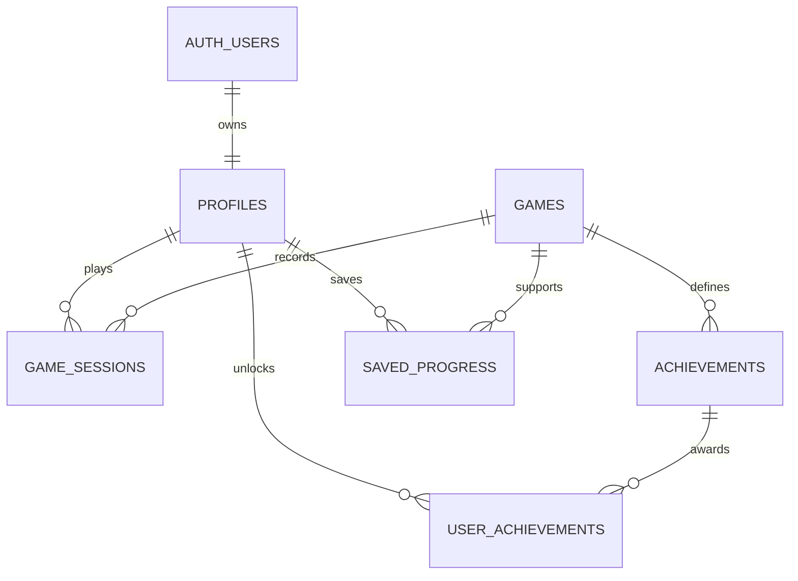

# CloudArcade — Design and Development of a Cloud-Based Online Gaming Platform Using Serverless Computing and Cloud Database Services

## Abstract

CloudArcade integrates three browser games with a managed cloud backend. React and Vite deliver a responsive frontend; Snake and Space Shooter use HTML5 Canvas, while 2048 uses a React tile interface. Supabase provides authentication, PostgreSQL persistence, and a serverless game-result endpoint. Cloudflare Pages is the intended frontend deployment target. This architecture demonstrates cloud hosting, Backend as a Service, serverless execution, authorization, and cross-device persistence without requiring remote GPU rendering.

## Problem and objectives

Standalone browser games commonly lack a shared account, persistent history, and unified rankings. This project brings games into one interface with player profiles, achievements and leaderboards. The implementation prioritizes desktop keyboard controls and includes touch controls and responsive layouts for mobile access.

## Implementation

The presentation layer includes a landing page, gaming dashboard, searchable library, authentication forms, leaderboards, achievements, profile editor and admin dashboard. Shared state manages the authenticated player, game catalog and errors. A service module keeps guest storage separate from cloud calls.

The gaming layer executes entirely in the browser. Snake advances on a fixed interval with grid collision detection. The 2048 engine compresses and merges tiles in directional order, creating one new tile after each valid move. Space Shooter uses requestAnimationFrame, time-based movement, projectiles, enemy collisions and a sixty-second survival period. Hidden tabs pause active gameplay.

The backend accepts only authenticated start and finish requests. The Edge Function verifies the JWT with Supabase Auth, derives the user ID from that verified identity, and calls restricted PostgreSQL functions. Database transactions lock account operations, issue sessions, validate submissions and award achievements atomically. Completed session retries return the existing result.

## Database relationships

`profiles` stores player identity without exposing authentication email addresses. `games` is the availability catalog. `game_sessions` stores starts, completions, scores and timestamps. `achievements` defines six milestones, and `user_achievements` records unique awards. `saved_progress` stores resumable 2048 snapshots. `admin_activity` audits catalog availability changes. Leaderboards are generated through a limited aggregate function rather than publishing private session history.

## Security design

All application tables enable RLS. Private records are visible to their owner and, where required, administrators. Column grants prevent clients from rewriting profile identity or creation timestamps. Browsers cannot insert scores or achievements. Only the server's service role may invoke score-writing database functions. Administrative privileges come from protected app metadata and are checked again inside database policies and functions.

Score validation checks ownership, session status, expiration, score range, scoring increments and rough timing limits for arcade games. This reduces arbitrary submissions but does not establish trusted gameplay. Client-supplied puzzle state is also untrusted. Authoritative replay verification is outside the mini-project's scope.

## Cloud computing concepts

| Concept | Implementation |
|---|---|
| Cloud hosting | Frontend deployment package for Cloudflare Pages |
| BaaS | Supabase Auth and managed database API |
| Serverless | Protected `game-api` Edge Function |
| Managed database | PostgreSQL schema, indexes, constraints and functions |
| Data persistence | Account-owned sessions, progress and achievements |
| Cloud security | JWT validation, HTTPS deployment, RLS and restricted grants |
| Scalability | Static frontend distribution and stateless function requests |
| Monitoring | Provider dashboards and admin usage aggregates |

## Validation and results

The automated suite tests game rules, achievement conditions, schema execution, score transactions, leaderboard output and RLS with a local PostgreSQL-compatible engine. Browser tests cover guest gameplay, persistence, puzzle save/resume, profile editing, library filtering, navigation, pause/restart and mobile overflow. The production Vite build validates frontend compilation. See `DEMO-AND-TESTING.md` for the cloud acceptance checklist.

Local checks do not prove hosted integration. Final evidence for the submitted report should include a real Pages URL, configured Supabase project, email authentication test and cross-device score/progress test. These require project-owner cloud setup.

## Costs, limitations and future work

The target budget is ₹0 within provider free-tier quotas. No VM, dedicated GPU or paid domain is required. Browser games are single-player; the cloud stores and shares account data. Managed service limits, email delivery configuration and account eligibility affect deployment. Advanced anti-cheat, multiplayer, tournaments, social features and normalized cross-game rankings are potential extensions.

## Conclusion

CloudArcade provides a practical separation between local browser gameplay and cloud-managed identity, storage and backend validation. The project demonstrates the main integration patterns of a serverless web application while keeping its game engines lightweight enough for a student mini-project.
